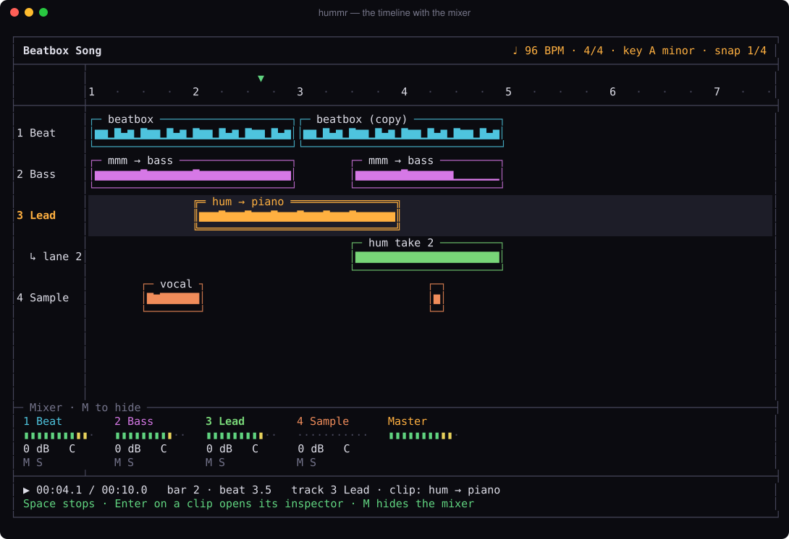
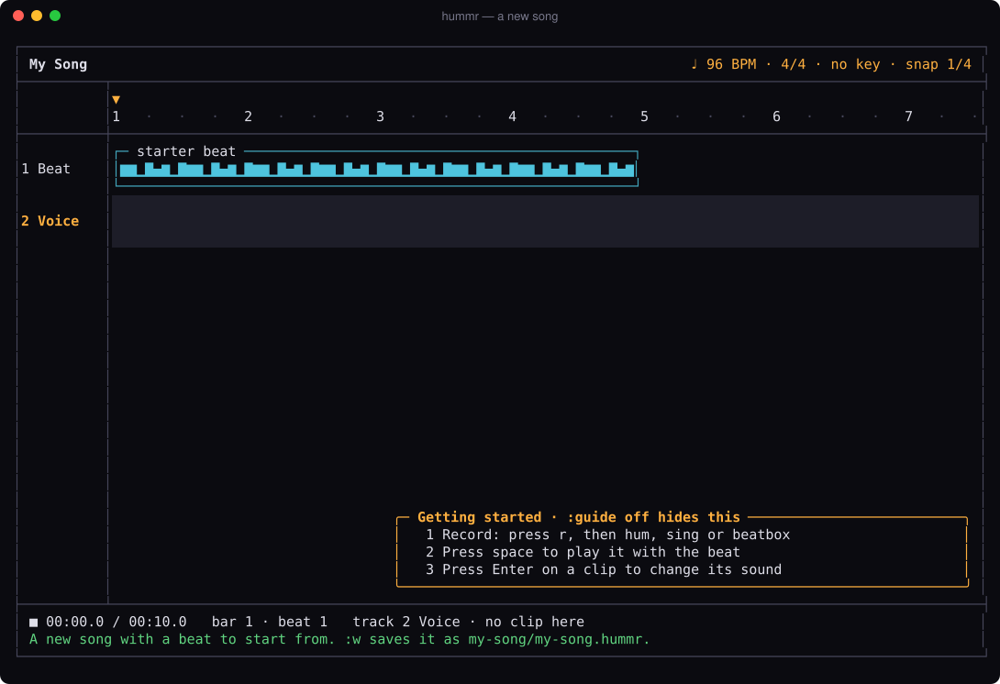

<h1 align="center">hummr</h1>

<p align="center">
  <b>Record first. Make it sound good after.</b><br>
  A terminal music studio for people who are good at code and not so good at music.
</p>

<p align="center">
  <a href="https://github.com/AbinavPallathoor/Hummr/actions/workflows/ci.yml"></a>
  
  
  
</p>

<p align="center">
  
</p>

Hum a bass line, beatbox a beat, sing a melody. Each recording lands on a
timeline as a clip. Then you shape it: snap a sloppy beat onto the grid, fit
a loop to the song's tempo, turn your hum into a piano or a bass guitar, turn
your beatbox into real drums, add reverb or a lo-fi sound, clean up the hiss.
Every change can be undone, and your recordings are never overwritten.

It runs offline in your terminal and is written entirely in Rust: no
network, no Python, no plugins. Songs are plain-text `.hummr` files you can
commit to git, and everything the editor does is also on the command line.

## Contents

- [Install](#install)
- [A five-minute tour](#a-five-minute-tour)
- [Tempo and snapping, in plain words](#tempo-and-snapping-in-plain-words)
- [Keys](#keys)
- [Command line](#command-line)
- [Honest limits](#honest-limits)
- [More](#more)

## Install

You need a Rust toolchain (1.85 or newer) from <https://rustup.rs>.

```sh
git clone https://github.com/AbinavPallathoor/Hummr.git
cd Hummr
cargo install --path crates/hummr-cli
```

That puts a `hummr` command on your path. Without installing, use
`cargo run --release -p hummr-cli --` instead of `hummr`.

To import mp3, flac and ogg files as well as WAV, build with
`cargo install --path crates/hummr-cli --features decode`.

| | |
|---|---|
| **macOS** | Your terminal app (Terminal, iTerm2, Ghostty, VS Code…) needs microphone access: **System Settings → Privacy & Security → Microphone**. Without it, macOS quietly records silence. Hummr notices and tells you how to fix it. |
| **Linux** | Install the ALSA headers before building: `sudo apt install libasound2-dev pkg-config` (Debian/Ubuntu) or `sudo dnf install alsa-lib-devel` (Fedora). |
| **Windows** | Nothing extra. |

**Better instrument sounds.** Out of the box, notes play on a small built-in
synth. For real instrument sounds, download any General MIDI SoundFont (a
`.sf2` file, e.g. GeneralUser GS or FluidR3) and point Hummr at it:

```sh
export HUMMR_SOUNDFONT=~/sounds/GeneralUser.sf2
# or put  soundfont = "/path/to/font.sf2"  in ~/.config/hummr/config.toml
```

## A five-minute tour

Use headphones, so the microphone doesn't hear the song playing back.

```sh
mkdir my-music && cd my-music
hummr
```



1. **You start with a beat.** `hummr` with no arguments opens the song in
   this folder, or makes a new one with a two-bar beat to hum over. The
   little guide in the corner ticks off as you go.
2. **Record.** The empty *Voice* track is selected. Press **`r`**: you hear
   one bar of clicks, then the beat plays and you hum, sing or beatbox.
   Press **`r`** again to stop. Your take appears as a clip right where the
   playhead was.
3. **Listen.** Press **`space`**. Move with **`h` `l`** (time) and
   **`j` `k`** (tracks).
4. **Change its sound.** Put the playhead on your clip and press
   **`Enter`**. The inspector opens and your clip loops on its own while you
   try things:
   - *Turn into* → **Notes on an instrument**: your hum becomes notes played
     on piano, bass, strings…; **Drums**: each beatboxed hit becomes a kick,
     snare or hi-hat; **My own sound**: your voice becomes the instrument.
   - *Effects*: presets (Lo-fi, Dreamy, Gritty, Telephone, Radio, Big hall,
     Warm, Bright) with an amount, plus distortion, reverb, echo, filter,
     pitch, speed, volume, pan, fades, reverse and loop.
   - *Fix*: clean background hiss, match the tempo, snap hits to the grid,
     snap notes to the key.
   `Esc` closes it. **`u`** undoes anything.
5. **Edit.** `s` splits a clip at the playhead, `d` duplicates it, `y`/`p`
   copy and paste, `x` deletes, **`H` `L`** move it along the grid and
   **`J` `K`** move it to another track. Two clips that overlap on a track
   get a second lane, so nothing is ever hidden.
6. **Mix.** **`M`** shows the mixer: level meters, volume, pan, mute, solo.
7. **Save and share.** `:w` saves the song (a folder with `my-song.hummr`
   and your recordings in `sources/`). `:export song.wav` writes a mix;
   `:export song.mid` writes the notes clips as MIDI.

Want to hear what it can do before recording anything?

```sh
hummr demo        # writes 21 example WAVs into ./demo/, described in demo/ABOUT.txt
```

Start with `00-song.wav`, then compare `01-beatbox-sloppy.wav` with
`02-beatbox-snapped.wav`.

## Tempo and snapping, in plain words

**Tempo** is how fast the beat goes, in beats per minute (BPM). The song
has one tempo, shown at the top right. Change it with `:bpm 100`, nudge it
with `<` and `>`, or tap it: press `T` a few times in time with the music.

**Recording to the click.** When you record in Hummr you hear the song's
beat, so your take is already at the song's tempo; nothing needs fixing.

**Bringing in a loop from elsewhere.** A sample made at another tempo will
drift against your beat. When you import one, Hummr listens for its beat
and, if it is more than 2% off, asks what to do:

- **Match to song.** Fit it to your tempo. For drums and beatbox, Hummr
  *cuts at each hit and moves the hits onto your beat*: every hit keeps its
  exact sound, only the gaps change. For humming and singing it *stretches*
  the sound to the new speed without changing its pitch.
- **Change song to N.** Use the loop's tempo for the whole song.
- **Leave as is.** Keep it untouched.

It also tells you how sure it is ("118 BPM, sure" or "118 BPM or 59? not
sure"); press `h` or `d` to say it is really half or double. The first clip
in an empty song simply sets the song's tempo.

**Snapping** moves each hit onto the nearest grid line, so a slightly
early or late beat sounds tight. The grid is the *snap* size at the top
right: `1/4` is every beat, `1/8` every half beat, `1/16` every quarter
beat, `1/8t` triplets. Change it with `:snap 1/8`. In the inspector,
*Fix → Snap to grid* cuts a clip at its hits and snaps them; `h`/`l` set
the strength from 0% (as played) to 100% (exactly on the grid), so you can
keep a little human feel. Snapped clips follow tempo changes: change the
BPM and every hit moves with the beat.

**Snap to key** does the same for notes: notes that are outside the song's
key (`:key A minor`) move to the nearest note that is in it.

## Keys

Press `?` in the app for all of these. The clip keys work on the clip
under the playhead on the selected row.

### Timeline

| Key | |
|---|---|
| `h` `l` / `←` `→` | Move the playhead one snap step |
| `j` `k` / `↓` `↑` | Next / previous row (a track, or its overlap lane) |
| `{` `}` | Previous / next bar |
| `Home` `End` | Start / end of the song |
| `+` `-` / `0` | Zoom in / out / fit the whole song |
| `space` | Play / stop from the playhead |
| `r` | Record on this track at the playhead (one bar of clicks first; `r` or `space` stops, `Esc` cancels) |
| `i` | Import a sample: built-in sounds, or WAVs in the project folder and the current folder |
| `Enter` | Open the clip's inspector |
| `e` | Edit the notes of a notes clip in the piano roll (`Esc` comes back) |
| `s` | Split the clip at the playhead |
| `x` | Delete the clip |
| `y` / `p` | Copy the clip / paste it at the playhead |
| `d` | Duplicate the clip right after itself |
| `H` `L` | Move the clip one snap step earlier / later |
| `J` `K` | Move the clip to the track below / above |
| `u` / `Ctrl-r` | Undo / redo |
| `n` | New track |
| `m` / `S` | Mute / solo this track |
| `M` | Show the mixer (and give it the keys) |
| `<` `>` | Tempo down / up by 1 BPM |
| `T` | Tap the tempo |
| `?` | Help |
| `:` | Type a command |
| `q` | Quit (asks once if there are unsaved changes) |

### Inspector (`Enter` on a clip)

| Key | |
|---|---|
| `Tab` / `1` `2` `3` | Turn into · Effects · Fix |
| `j` `k` | Choose a setting |
| `h` `l` | Change it (a run of presses is one undo step) |
| `Enter` | Do it: turn into, match tempo, snap to the grid, snap to key |
| `space` | Loop the clip on its own while you change it (on by default) |
| `u` / `Ctrl-r` | Undo / redo |
| `Esc` | Close |

### Mixer (`M`)

| Key | |
|---|---|
| `h` `l` | Choose a track |
| `j` `k` | Volume down / up (1 dB) |
| `[` `]` | Pan left / right |
| `m` / `S` | Mute / solo |
| `0` | Reset volume and pan |
| `Esc` / `M` | Back to the clips / hide the mixer |

### Commands

| Command | |
|---|---|
| `:w [file.hummr]` | Save (to a new file if given) |
| `:q` · `:q!` · `:wq` | Quit · quit without saving · save and quit |
| `:export song.wav` | Export the mix as WAV (`song.mid` exports the notes clips as MIDI) |
| `:bpm 120` · `:bpm half` · `:bpm double` | Tempo |
| `:time 3/4` | Time signature |
| `:key A minor` · `:key none` | Song key |
| `:snap 1/8` · `:snap off` | Snap size: `1/4`, `1/8`, `1/16`, `1/8t` or off |
| `:track name Bass` · `:track new` · `:track delete` | Tracks |
| `:anim off` | Turn off animations |
| `:guide` | Show the three-step guide again |

The notes editor (`e`) is the piano roll from Hummr 0.1; its keys are in
[docs/USAGE.md](docs/USAGE.md#the-notes-editor).

## Command line

```sh
hummr                                # open the song here, or start a new one
hummr my-song/my-song.hummr          # open a song
hummr new "Night Drive"              # create night-drive/night-drive.hummr
hummr export song.hummr -o mix.wav   # render the mix (or -o notes.mid)
hummr demo                           # example WAVs into ./demo/

hummr detect loop.wav --hits         # tempo, beat, confidence and every hit
hummr snap loop.wav --bpm 96 --grid 1/8 --strength 0.8
hummr clean voice.wav --strength 0.8 --noise 0:0.5
hummr record -o take.wav --seconds 8
hummr transcribe take.wav --key auto --quantize 1/8 -o lead.mid --explain
hummr edit take.wav                  # the 0.1 hum-to-notes editor
```

## Honest limits

Hummr is built and tested by measurement on synthetic sounds, not by ear;
the numbers are in [docs/LIMITS.md](docs/LIMITS.md). The main ones:

- Stretching drums blurs their hits, which is why rhythmic clips are cut and
  snapped instead. Big pitch shifts sound like a smaller or bigger person.
- Tempo detection is reliable for clear beats between 80 and 160 BPM. It
  says "no steady beat" for humming and pads rather than guessing.
- Noise cleanup handles steady hiss and hum, not voices, music or traffic.
- Turning into notes follows one note at a time (no chords).
- Microphone and speaker delay are not compensated, so takes can land a few
  milliseconds late; nudge them with `H`/`L` at a fine snap if you hear it.
- There is no bundled SoundFont; without one, notes use the built-in synth.

## More

- [docs/USAGE.md](docs/USAGE.md): the full guide, including the notes editor
  and the project file format.
- [docs/ARCHITECTURE.md](docs/ARCHITECTURE.md): how the code is organised.
- [docs/LIMITS.md](docs/LIMITS.md): measured limits.
- [CHANGELOG.md](CHANGELOG.md).

Development: `cargo test` runs 254 tests (synthetic-audio DSP,
timeline key-driven tests, text-screen snapshots);
`cargo clippy --all-targets -- -D warnings` must stay clean. Screens can be
regenerated with `cargo run -p hummr-tui --example screenshots -- -`.

## License

MIT. See [LICENSE](LICENSE).
