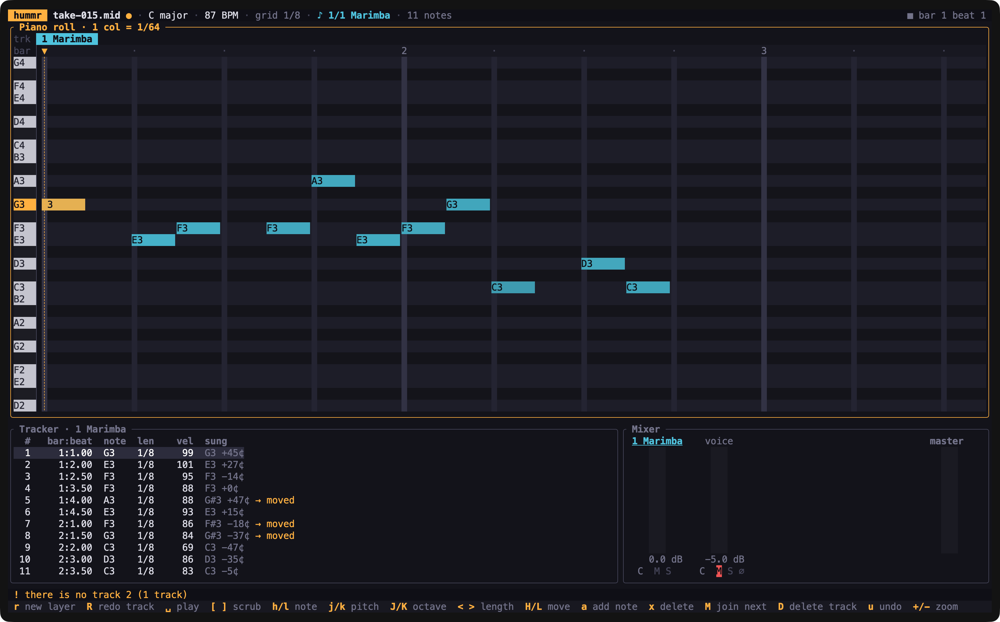

<h1 align="center">hummr</h1>

<p align="center">
  <b>Hum it. Hear it on a real instrument.</b><br>
  A terminal music editor for people who are good at code and not so good at music.
</p>

<p align="center">
  <a href="https://github.com/AbinavPallathoor/Hummr/actions/workflows/ci.yml"></a>
  
  
  
</p>

<p align="center">
  
</p>

Press `r` and hum a tune. Hummr hears the pitch, works out the notes, the key
and the tempo, cleans up the wobbly bits, and gives you a melody you can play
on a violin, flute, cello or 125 other instruments. Then hum another part over
it. Each one becomes a new track, and together they make a song.

It runs offline in your terminal and is written entirely in Rust. It needs no
network or Python, and it works with your coder habits: keyboard first, a `:`
command line, MIDI files you can commit to git, and a CLI for scripting.

## Contents

- [Features](#features)
- [Install](#install)
- [Quick start](#quick-start)
- [The editor](#the-editor)
- [Command line](#command-line)
- [How it works](#how-it-works)
- [Development](#development)
- [Roadmap](#roadmap)

## Features

- 🎤 **Hum to notes.** pYIN pitch tracking with HMM smoothing turns your
  voice into clean notes. It keeps vibrato, scoops and drifting pitch inside a
  single note and holds long notes for as long as you held them.
- 🎼 **Forgiving about music.** It detects the key and snaps stray notes into
  it, fixes it if you sang the whole thing a bit flat, and lines notes up on a
  tempo grid. With `--explain` it tells you every change it made and why.
- 🎛️ **Build a song in layers.** `r` records a new instrument layer while the
  song plays along. `R` re-records just one instrument from the playhead. A
  one-bar count-in keeps every take in time.
- ✏️ **Edit like vim.** `h j k l` to move around and change pitch, `a` to add
  notes, `:notes C4 1/4 E4 1/8` to type a phrase, `u` to undo, and `:` for
  everything else.
- 🎚️ **Mixer with live meters.** Per-track volume, pan, mute and solo, plus
  your recorded voice on its own strip.
- 💾 **Plain files.** Songs save as standard multi-track MIDI, each instrument
  on its own track. Your takes are kept as WAV files in `./takes`.

## Install

You need a Rust toolchain (1.85 or newer) from <https://rustup.rs>.

```sh
git clone https://github.com/AbinavPallathoor/Hummr.git
cd Hummr
cargo install --path crates/hummr-cli
```

That puts a `hummr` command on your path. If you'd rather not install it, run
`cargo run --release -p hummr-cli` from the repo instead.

**Platform notes**

| | |
|---|---|
| **macOS** | Your terminal app (Terminal, iTerm2, Ghostty, VS Code…) needs microphone access: **System Settings → Privacy & Security → Microphone**. Without it, macOS quietly records silence. Hummr notices and tells you how to fix it. |
| **Linux** | Install the ALSA headers before building: `sudo apt install libasound2-dev pkg-config` (Debian/Ubuntu) or `sudo dnf install alsa-lib-devel` (Fedora). |
| **Windows** | Nothing extra. |

Use headphones when you record layers, so the microphone doesn't pick up the
song playing back.

## Quick start

```sh
hummr
```

1. Press **`r`**, hum a short melody (try "Twinkle Twinkle"), and press
   **`r`** again. A second later your notes appear in the piano roll.
2. Press **`space`** to hear it back. Press **`i`** and pick an instrument.
3. Press **`r`** again to hum a second part over the first. You'll get a
   one-bar count-in, and then the song plays while you sing.
4. Press **`:w`** to save the song as a MIDI file.

No microphone handy? Make a synthetic hummed take and open that:

```sh
cargo run -p hummr-core --example synth_take -- take.wav
hummr take.wav
```

## The editor

The screen has a **piano roll** at the top. A tab for each track sits above
it, numbered `1`, `2`, `3`…, and the other tracks show dulled behind the one
you're editing. Below the roll are the **tracker** (the current track's notes
as a list) and the **mixer**. The playhead is the `▼` line: playing,
recording and adding notes all start there.

### Recording

| Key | |
|---|---|
| `r` | On an empty song, record the first take freely; it sets the tempo and key. After that, `r` records a **new layer** on a new track with a different instrument, while the song plays along. |
| `R` | **Re-record this track** from the playhead. Whatever you sing over is replaced; the rest stays. |
| `r` / `space` / `enter` | Stop recording and transcribe. `esc` cancels. |

### Moving around

| Key | |
|---|---|
| `space` | Play / stop from the playhead |
| `[` `]`  `{` `}` | Move the playhead a beat / a bar (`Home` goes to the start) |
| `0` | Zoom out to show every note of every track (`+` / `-` zoom) |
| `1`–`9` | Switch track |
| `h` `l` | Previous / next note |
| `tab` | Next panel: roll → tracker → mixer |

### Editing notes

| Key | |
|---|---|
| `a` | Add a note at the playhead. It copies the previous note's pitch, and pressing `a` again writes the next note |
| `j` `k` / `J` `K` | Pitch down / up a semitone / an octave |
| `<` `>` | Shorter / longer by one grid step |
| `H` `L` | Earlier / later by one grid step |
| `M` | Join with the next note into one held note |
| `x` | Delete the note |
| `u` | Undo (also removes a whole recorded layer or deleted track) |
| `i` | Instrument for this track |
| `D` | Delete this track |
| `t` | Switch the tracker to **why notes changed** |

### Mixer (press `tab` to reach it)

`h` `l` select a strip · `j` `k` volume · `[` `]` pan · `m` mute · `s` solo ·
`x` delete that track.

### Commands

| Command | |
|---|---|
| `:w [file.mid]` | Save every track as a multi-track MIDI file |
| `:export song.wav` | Export an audio mix (or `.mid`) |
| `:open take.wav` / `:open song.mid` | Open a recording or a MIDI file |
| `:notes C4 1/4 E4 1/8 r 1/8 G4 1/2` | Type notes in at the playhead |
| `:track new cello` · `:track 2` · `:track del` · `:track name Bass` | Manage tracks |
| `:instrument flute` · `:transpose -12` | Change this track's instrument, or shift it an octave down |
| `:key D minor` · `:tempo 100` · `:quantize 1/16` | Song settings |
| `:anim off` · `:mouse on` | Turn off animations, or turn on the mouse (click notes and the ruler, right-click to add a note) |
| `:q` · `:q!` · `:wq` | Quit |

**Note notation.** A note name with its octave (`C4` is middle C), then its
length as a fraction of a whole note: `1/4` is a beat, `1/8` half a beat, `3/8`
dotted, `1/8t` a triplet. `r` is a rest.

## Command line

Everything the editor does to a take is also available from scripts.

```console
$ hummr transcribe take.wav --key auto --quantize 1/8 -o lead.mid --explain
take.wav  10.1 s · 44.1 kHz
  tuning   sung 27¢ flat on average; corrected
  key      C major  (detected, score 0.98; runner-up A minor 0.63)
  tempo    100 BPM  (detected, 1/8 grid, fit 0.97)
  notes    14

  C4 1/4 C4 1/4 G4 1/4 G4 1/4 A4 1/4 A4 1/4 G4 1/2 F4 1/4 F4 1/4 E4 1/4 E4 1/4
  D4 1/4 D4 1/4 C4 1/2

why notes changed:
    -    0.386s  length  held 13 notes through the short breath before the next note
  #4     2.155s  timing  start 2.155s → bar 1 beat 4 (+10 ms)
  ...
wrote lead.mid
```

| Option | |
|---|---|
| `--key auto` | Detect the key and snap stray notes into it. You can also give a key (`"D minor"`, `F#m`, `Bb`, `"A minor pentatonic"`), or `none` to keep every note as sung |
| `--quantize 1/8` | Grid: `1/4`, `1/8`, `1/16`, `1/8t` or `off` |
| `--tempo auto` | Detect the tempo, or give one (`--tempo 96`) |
| `--explain` | List every change, for example `moved F#4 to F4: outside C major` |
| `--no-tuning` | Don't correct for singing sharp or flat |
| `--pitch-csv f.csv` | Dump the frame-by-frame pitch, for debugging a tricky take |

```sh
hummr record -o take.wav             # record from the default microphone (Enter stops)
hummr record -o take.wav --seconds 8
hummr edit song.mid --no-anim        # open the editor on a file
```

The input is WAV for now. To convert a phone memo, run
`ffmpeg -i memo.m4a take.wav`.

## How it works

```
 voice ──► pYIN pitch tracking ──► note segmentation ──► key + snapping ──► tempo + grid ──► notes
           (YIN × 100 thresholds,   (note HMM, energy      (Krumhansl–         (onset phase
            pitch/voicing HMM)       dips, tuning fix)      Schmuckler)          alignment)
```

1. **Pitch.** YIN runs with 100 thresholds weighted by a Beta prior, which
   gives several candidate pitches per 5 ms frame. A Viterbi pass over a
   pitch-and-voicing HMM then picks the smoothest believable path, which removes
   octave jumps and glitches. It's implemented from scratch in `hummr-core`.
2. **Notes.** A note-level HMM (one state per semitone, plus silence) starts a
   new note only when the pitch really moves, so vibrato and scoops stay inside
   one note. A quick dip in loudness, as in "da-da", splits repeated notes; a
   slow swell does not. If you sing consistently sharp or flat, that's measured
   and removed.
3. **Key.** Krumhansl–Schmuckler key finding, adjusted so that notes you sang
   clearly count against keys that don't contain them. Stray notes then snap
   to the nearest in-key pitch.
4. **Rhythm.** The tempo is the one whose grid best fits your note onsets.
   Short breaths count as part of the note, not as rests, so held notes keep
   their length. Later takes reuse the song's tempo, anchored to the count-in.

Every step records what it changed, which is what `--explain` and the **why**
panel show.

## Development

```sh
cargo build
cargo test                                   # ~100 tests, incl. synthetic-audio DSP and golden MIDI files
cargo clippy --all-targets -- -D warnings
```

| Crate | |
|---|---|
| [`hummr-core`](crates/hummr-core) | The audio engine: pitch tracking, segmentation, key, rhythm, preview synth, recording and playback (`cpal`), MIDI and WAV. It has no UI dependencies. |
| [`hummr-tui`](crates/hummr-tui) | The terminal editor (`ratatui`, with `tachyonfx` for transitions). |
| [`hummr-cli`](crates/hummr-cli) | The `hummr` binary. |

- **Golden files.** The DSP tests sing synthetic melodies with vibrato, drift,
  breath noise and fading. Golden MIDI files live in
  `crates/hummr-core/tests/golden` (regenerate with `UPDATE_GOLDEN=1 cargo test`).
- **Screens as text.** To see a screen without a terminal, run
  `cargo run -p hummr-tui --example screen -- take.wav "lll" 110 34`.

## Roadmap

Hummr is young. Here's what works today and what's coming:

- [x] Hum-to-MIDI transcription with explanations
- [x] Terminal editor: recording, layers, re-recording, note editing, mixer
- [x] Multi-track MIDI save/load, WAV export
- [ ] **Real instrument sound.** Playback currently uses a small built-in
      preview synth. Next is SoundFont rendering with the free GeneralUser GS
      bank
- [ ] Plain-text TOML song files and `hummr mix`
- [ ] `hummr watch` to re-render on every save
- [ ] Auto accompaniment: `hummr add bass`, `hummr add drums`
- [ ] Beatbox to drums (kick / snare / hi-hat classifier)

**Known limitations.** Each take has one tempo, so a singer who speeds up a
lot will quantize less well. A brief voice crack in the middle of a long note
looks like two notes (press `M` to join them). Automatic key detection picks
between major and minor keys; use `:key` for other modes. Speaker and
microphone delay isn't compensated yet.

## License

MIT. See [LICENSE](LICENSE).
